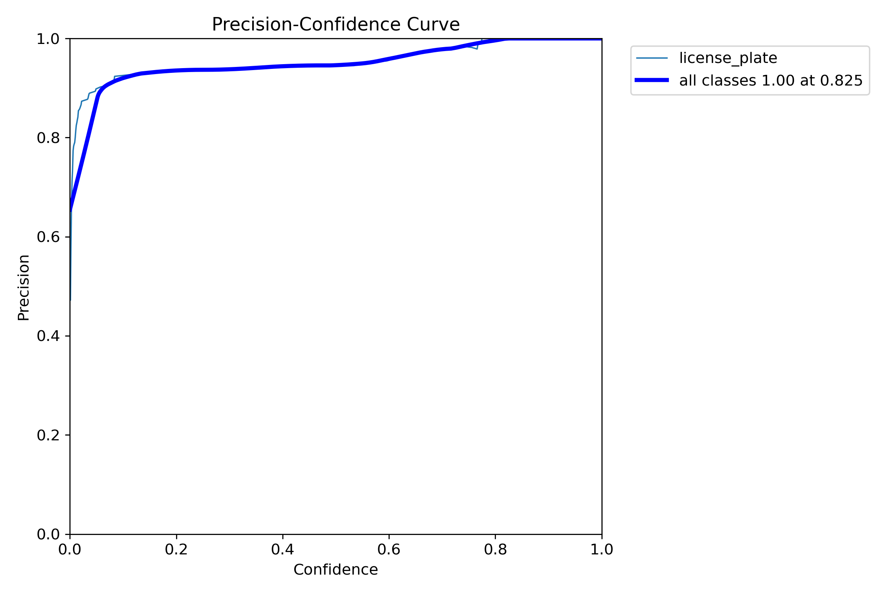
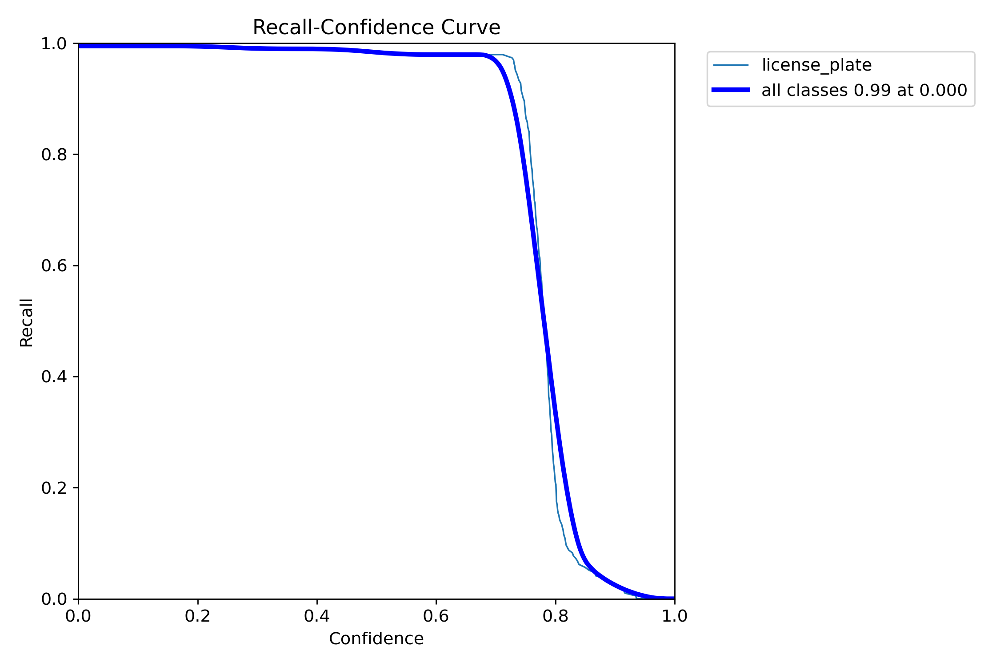
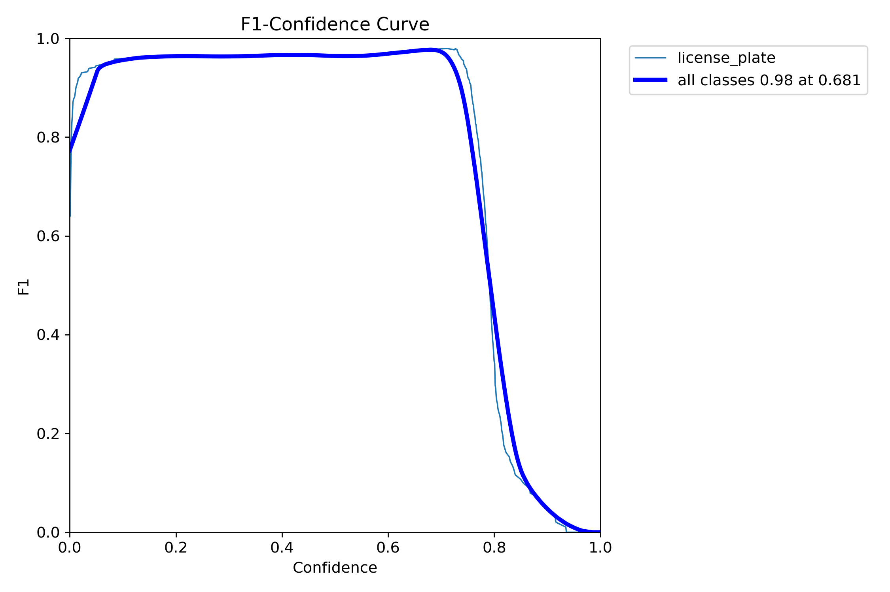
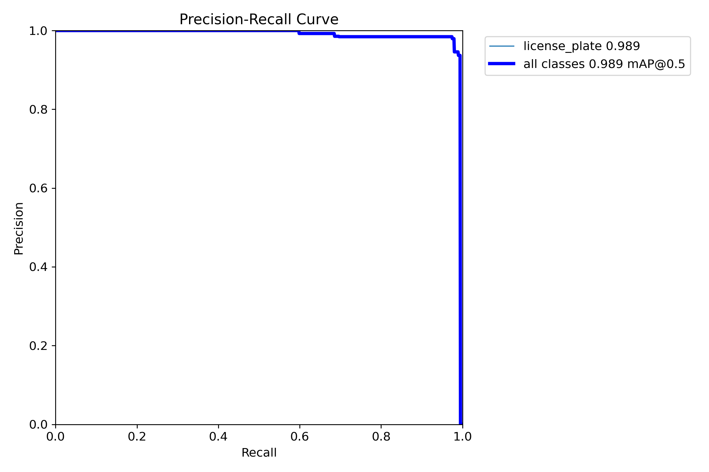
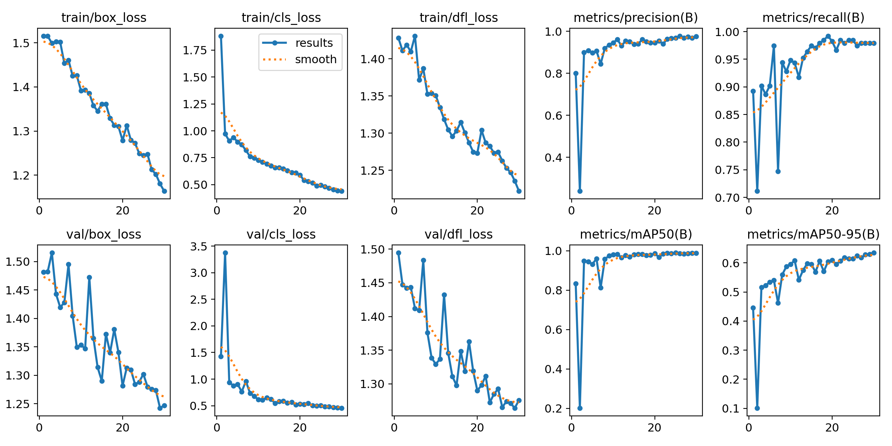
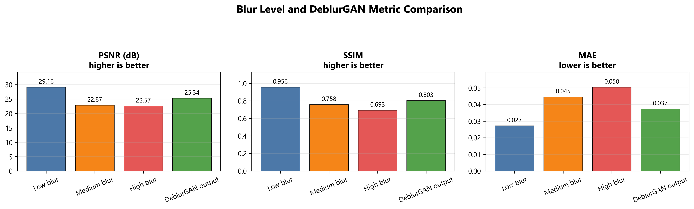

# Bangla Vehicle Plate Recognition Pipeline

This project is a computer vision pipeline for detecting Bangladeshi vehicle license plates, restoring blurred plate crops, and reading Bengali text from the plate. It was built as a standalone portfolio project and demonstrates practical skills in image preprocessing, object detection, deep learning, and OCR pipeline design.

Dataset source: [Bangladeshi Vehicle License Plate on Kaggle](https://www.kaggle.com/datasets/sifatkhan69/bangladeshi-vehicle-license-plate)

## Project Overview

The repository contains an end-to-end workflow for:

1. Preparing a clean YOLO-formatted dataset for vehicle plate detection.
2. Training a YOLOv8-based detector to localize license plates.
3. Restoring degraded plate crops using a DeblurGAN-based image enhancement model.
4. Recognizing Bengali plate text with a YOLOv8 token-based OCR stage.

This is designed as a reusable research/portfolio project rather than a thesis-specific deliverable, and it can be adapted for CV applications, machine learning experiments, and applied computer vision demos.

## Core Technologies

- Python
- PyTorch
- Ultralytics YOLOv8
- OpenCV
- Albumentations
- NumPy / Pandas / Matplotlib
- DeblurGAN-based restoration
- OCR pipeline with token detection and plate reconstruction

## Workflow

### 1. Dataset preparation
- Loads the Kaggle dataset in YOLO-style `train`, `valid`, and `test` folders.
- Converts annotations into plate-level detection labels.
- Keeps OCR token labels needed for Bengali text recognition.

### 2. Plate detection
- Trains a one-class YOLOv8 model for `license_plate` detection.
- Uses clean, blurred, and distorted variants for robustness.
- Saves optimized detection weights in the `runs/` directory.

### 3. Deblurring and restoration
- Uses YOLOv8-detected plate crops as input for DeblurGAN training.
- Restores degraded plate images and compares them using image quality metrics.
- Improves downstream OCR performance on low-quality inputs.

### 4. Bengali OCR
- Detects Bengali plate characters and tokens using a YOLOv8-based OCR model.
- Reconstructs the final plate string from detected token order.
- Evaluates recognition quality using accuracy, CER, and WER metrics.

## Repository Structure

```text
.
├── README.md
├── LICENSE
├── clean_dataset_yolov8_preprocessing.ipynb
├── yolov8_workflow.ipynb
├── deblurgan_workflow.ipynb
├── ocr_workflow.ipynb
├── yolov8s.pt
├── dataset/
├── clean_dataset_processed/
├── deblurgan_data/
├── runs/
└── ...
```

## Requirements

- Windows PowerShell or VS Code terminal
- Python available as `python`
- JupyterLab
- NVIDIA GPU recommended for faster model training; CPU can be used for smaller experiments

Install dependencies:

```powershell
python -m venv --clear .venv
.\.venv\Scripts\Activate.ps1
python -m pip install --upgrade pip
python -m pip install torch torchvision torchaudio --index-url https://download.pytorch.org/whl/cu128
python -m pip install jupyterlab numpy pandas matplotlib scikit-learn opencv-python albumentations ultralytics easyocr pytesseract
```

For CPU-only training, use:

```powershell
python -m pip install torch torchvision torchaudio --index-url https://download.pytorch.org/whl/cpu
```

If you want the full DeblurGAN backbone support, you can also install:

```powershell
python -m pip install timm
```

## How to Run

Start JupyterLab from the project root:

```powershell
cd "your folder path"
jupyter lab
```

Then run the notebooks in this order:

1. `clean_dataset_yolov8_preprocessing.ipynb`
2. `yolov8_workflow.ipynb`
3. `deblurgan_workflow.ipynb`
4. `ocr_workflow.ipynb`

## Dataset

The project uses the Kaggle dataset for Bangladeshi vehicle license plates and expects a structure similar to:

```text
dataset/
|-- train/
|   |-- images/
|   `-- labels/
|-- valid/
|   |-- images/
|   `-- labels/
|-- test/
|   |-- images/
|   `-- labels/
`-- data.yaml
```

The preprocessing notebook creates a cleaned, plate-level training dataset in `clean_dataset_processed/`.

## Example Outputs

| Output path | Contents |
| --- | --- |
| `clean_dataset_processed/` | Cleaned plate detection dataset |
| `runs/bangla_plate_yolov8/` | YOLOv8 training logs, validation metrics, and checkpoints |
| `deblurgan_data/` | Paired blurry and restored training samples |
| `runs/deblurgan_clean_dataset_irv2_fpn_psnr_v2/` | DeblurGAN training results and restoration metrics |
| `runs/ocr_text_recognition_psnr_v2/` | OCR outputs for restored plate crops |
| `runs/ocr_yolov8_input_token_ocr/` | OCR outputs for direct detector-crop input |

## Training Curves and Key Metrics

The project includes actual training and evaluation artifacts generated during model development. These outputs make it easier to explain the model behavior and show the learning progression in a portfolio or interview.

### YOLOv8 plate detection curves











### DeblurGAN restoration metrics



### OCR evaluation summary

| OCR input | Samples | Exact plate accuracy | CER | WER |
| --- | ---: | ---: | ---: | ---: |
| DeblurGAN-restored crops | 52 | 92.31% | 0.76% | 2.24% |
| YOLOv8 detector crops | 49 | 81.63% | 2.35% | 5.44% |

### Detection metrics

| Metric | Value |
| --- | ---: |
| Precision | 0.9759 |
| Recall | 0.9794 |
| mAP@50 | 0.9886 |
| mAP@50:95 | 0.6350 |

These figures and metrics show the actual training progression and performance improvements across detection, deblurring, and OCR stages.

## Project Results

The pipeline achieved strong detection and OCR results on the project dataset:

These metrics demonstrate the effectiveness of the full pipeline for a real-world document-and-vehicle recognition task, especially when image restoration is used before OCR.

## Why This Project is Good for a CV

This project highlights practical experience in:

- Computer vision and image preprocessing
- Object detection with YOLO
- Deep learning model training and evaluation
- Model pipeline design and experimentation
- Data preparation, evaluation, and performance analysis
- Applying AI to real-world visual recognition problems

It is suitable for inclusion in a portfolio, resume, or GitHub profile as an applied AI/computer vision project.

## Notes

- Downloaded datasets, checkpoints, model outputs, and generated training artifacts are intentionally not committed to Git because they are large and can be recreated by running the notebooks.
- The project source code is provided under the [MIT License](LICENSE).
- Dataset usage is subject to the Kaggle dataset terms and attribution requirements.
